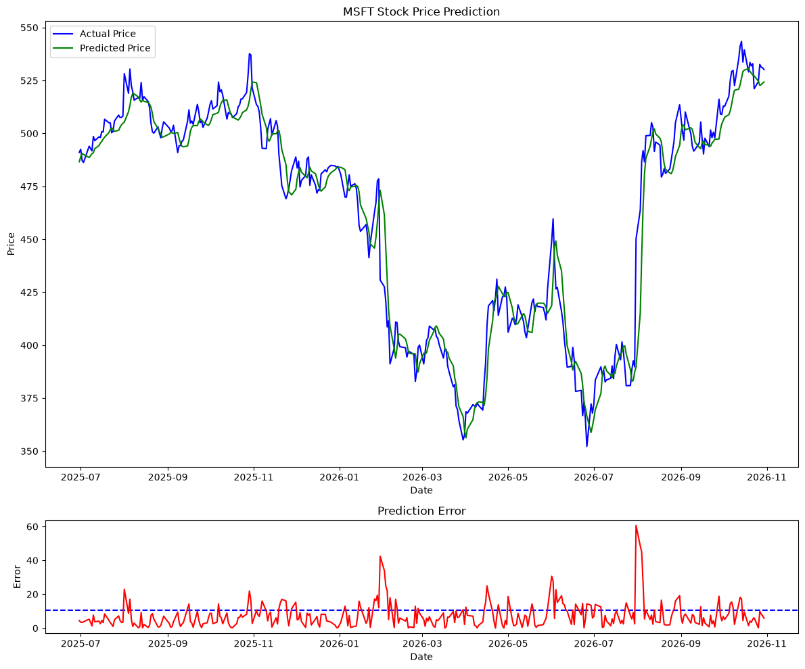
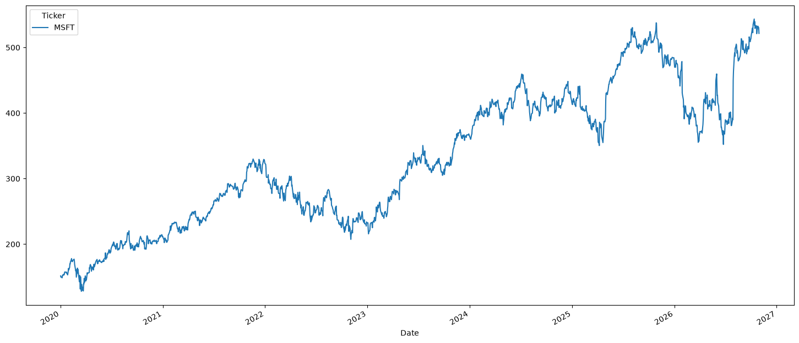

<div align="center">
  <h1>📈 Stock Price Prediction</h1>
  <p><em>Previsão do preço de fechamento de ações com uma rede LSTM em PyTorch</em></p>
  <p>
    
    
    
    
    
    
  </p>
  <p>
    <b>Projeto de estudo</b> | Desenvolvido por <a href="https://github.com/jaoAprendiz"><b>jaoAprendiz</b></a>
  </p>
  <p>
    <a href="https://youtu.be/IJ50ew8wi-0?si=y7394SRkMxFzNSom"></a>
  </p>
</div>

> [!WARNING]
> **Este projeto é exclusivamente educacional** e não serve como ferramenta de previsão nem de apoio a decisões de investimento. Nas palavras do autor do tutorial:
>
> *"DISCLAIMER: None of this is financial advice. This is purely a programming tutorial and I am not responsible for any financial decisions you make. Don't use this for actually trying to predict stock prices."*

---

## 📌 O Projeto

Projeto de Machine Learning desenvolvido para praticar séries temporais e redes neurais recorrentes, a partir do tutorial [Stock Price Prediction in Python with PyTorch - Full Tutorial](https://youtu.be/IJ50ew8wi-0?si=y7394SRkMxFzNSom).

O objetivo é prever o preço de fechamento diário da **Microsoft (MSFT)** usando apenas os preços dos dias anteriores.

---

## 🧪 Metodologia

| Etapa | O que foi utilizado |
| :--- | :--- |
| **Dados** | Preço de fechamento diário da MSFT de 01/2020 a 10/2026 (1.717 pregões), obtido do Yahoo Finance. |
| **Normalização** | Padronização dos preços com `StandardScaler` (média 0 e desvio padrão 1). |
| **Sequências** | Janelas deslizantes de 30 dias: os 29 primeiros são a entrada e o 30º é o valor a prever. |
| **Treino e teste** | Divisão cronológica, sem embaralhar: 80% para treino (1.349 janelas) e 20% para teste (338 janelas). |
| **Modelo** | LSTM com 2 camadas e 32 unidades ocultas, seguida de uma camada linear. |
| **Treinamento** | 200 épocas com perda MSE e otimizador Adam (taxa de aprendizado de 0,01). |
| **Avaliação** | RMSE em dólares, calculado após reverter a normalização. |

---

## 📊 Resultados

| Conjunto | RMSE (USD) |
| :--- | :--- |
| **Treino** | 5,86 |
| **Teste** | 10,55 |

- **Convergência:** a perda de treino (MSE sobre os dados normalizados) caiu de **0,74** na primeira época para **0,0033** na época 175.
- **Período de teste:** de julho de 2025 a outubro de 2026, o preço variou entre cerca de US$ 350 e US$ 545, então o RMSE de US$ 10,55 equivale a algo entre 2% e 3% do preço.
- **Comportamento:** a previsão acompanha a tendência do preço real com um pequeno atraso.
- **Maiores erros:** aparecem nos movimentos bruscos, chegando a cerca de US$ 60 em agosto de 2026.

*Os valores são de uma única execução e mudam a cada treino, pois os pesos iniciais são aleatórios e os dados baixados vão até a data atual.*

### 🖼️ Preço real vs. previsto no período de teste

<div align="center">
  
</div>

### 🖼️ Histórico do preço de fechamento

<div align="center">
  
</div>

---

## 🛠️ Tecnologias Utilizadas

| Ferramenta | Finalidade no Projeto |
| :--- | :--- |
| **yfinance** | Download do histórico de cotações do Yahoo Finance. |
| **pandas & NumPy** | Manipulação dos dados e criação das sequências. |
| **scikit-learn** | Normalização dos preços e cálculo do RMSE. |
| **PyTorch** | Construção e treinamento da rede LSTM. |
| **Matplotlib** | Gráficos de preço e de erro de previsão. |
| **JupyterLab** | Ambiente de desenvolvimento do notebook. |

---

## 🚀 Como Rodar o Projeto

É preciso ter conexão com a internet, pois os dados são baixados na hora da execução.

```bash
# Clone o repositório
git clone https://github.com/jaoAprendiz/stock-price-predition.git
cd stock-price-predition

# Crie e ative um ambiente virtual
python -m venv venv
source venv/bin/activate  # No Windows: venv\Scripts\activate

# Instale as dependências
pip install -r requirements.txt

# Abra o notebook e execute as células em ordem
jupyter lab main.ipynb
```

---

## 📄 Créditos

- **Tutorial:** [Stock Price Prediction in Python with PyTorch - Full Tutorial](https://youtu.be/IJ50ew8wi-0?si=y7394SRkMxFzNSom).
- **Dados:** [Yahoo Finance](https://finance.yahoo.com/), obtidos via `yfinance` e usados apenas para fins educacionais.
